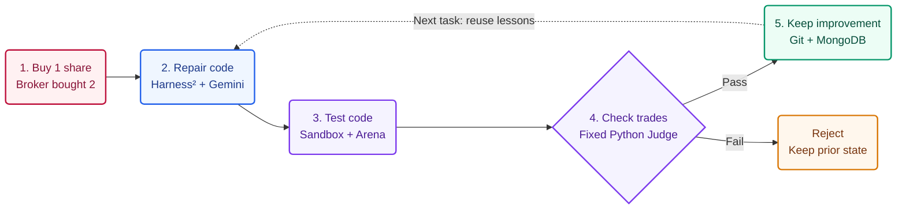

# TradeOnce hackathon submission

- **Team / project:** TradeOnce
- **Track:** The System That Gets Better
- **Project Description:** 2,104 / 3,000 characters
- **Repository:** https://github.com/geeteshCh/tradeOnce
- **One-minute YouTube demo:** TODO — add the video URL before submitting.
- **Submission form:** https://cerebralvalley.ai/e/aie-code-2026-hackathon/hackathon/submit

## System design

**Asked for 1 share. Received 2. Repair the code; keep the lesson.**

**AI writes; fixed code verifies.** Only approved lessons reach the next repair. Model weights stay fixed.

## Project Description

You tell your trading agent to buy 1 share. It buys 2. The broker completed the first trade, but its reply disappeared; the bot retried and bought again.

This is a documented broker-integration risk. Alpaca staff explain it here: https://forum.alpaca.markets/t/open-orders-failing-to-close-on-paper-account/18533

TradeOnce repairs the code, independently verifies the trades, and remembers what worked.

- Repair: Google Research Harness² proposes better instructions, probes them by running Gemini 4 Argon's Python fixes, then composes improved guidance (Propose-Probe-Compose).
- Verify: patches use typed Pydantic contracts and run in a macOS sandbox against a fault-injecting broker simulator. A fixed Python Auditor checks the broker ledger, regressions, and private tests. The Builder cannot edit the Judge or its hidden cases.
- Remember: Git versions the approved code. MongoDB saves verified Builder guidance with revision checks; rejection keeps the previous state. The next task starts with broken code and reloads the approved lesson through a fresh database connection.

Measured results:
- Recorded coding run: timeout repair took 3 proposals / 147 seconds; a related server-error repair with the saved lesson took 1 proposal / 36 seconds. Both passed 5/5 hidden checks. Different tasks: observed lesson transfer, not a controlled speedup.
- Six matched Alpaca paper-broker scenarios: the original Executor made 3 duplicate orders; the Gemini-written version made 0 and completed 6/6 safely by our checks. The unmodified ai-hedge-fund pipeline runs through our adapter. These use fake money, real broker APIs, injected faults, and cached stand-in analyst signals.

Why Harness² fits: broker failures recur in related forms. The framework improves how Gemini repairs them, carrying verified lessons into the next task. Execution feedback improves the harness; model weights stay frozen.

Current limits: the saved Gemini Executor passes 8/9 Arena cases; partial fills remain unsolved. The working coding demo is standalone; integration with the shared multi-agent round loop is incomplete.

## Evidence

- [Broker risk and primary sources](docs/demo-evidence.md)
- [Recorded Gemini repair run](demo/recorded/argon-coding.json)
- [Alpaca paper-broker comparison](agent_bridge/reports/side_by_side.json)
- [Saved repair and provenance](demo/promoted/argon-v2/PROVENANCE.md)

## Before submitting

- Add the YouTube URL; paste only the Project Description into the form.
- Label recordings, paper trading, injected faults, and stand-in signals in the video.
- Show work built during the event and credit Harness², Gemini, MongoDB, and ai-hedge-fund.
