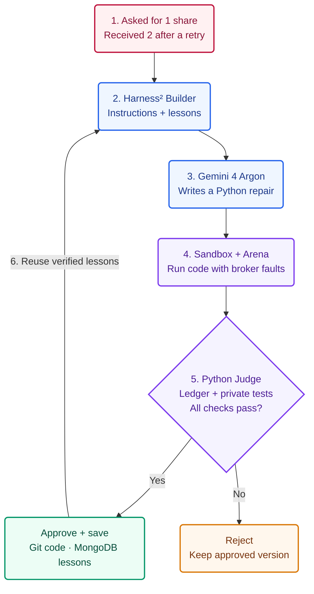

# TradeOnce hackathon submission

- **Team name:** TradeOnce
- **Project name:** TradeOnce
- **Track:** The System That Gets Better
- **Project Description length:** 2,810 / 3,000 characters
- **Public GitHub repository:** https://github.com/geeteshCh/tradeOnce
- **One-minute YouTube demo:** TODO — add the YouTube video URL before submitting.
- **Submission form:** https://cerebralvalley.ai/e/aie-code-2026-hackathon/hackathon/submit

## Project Description

You tell your trading agent to buy 1 share. It buys 2. The broker completed the first trade, but its reply disappeared; the bot retried and bought again. TradeOnce repairs that execution code, independently checks the actual trades, and carries approved lessons into the next repair.

This is a documented broker-integration risk. Alpaca staff explain it here: https://forum.alpaca.markets/t/open-orders-failing-to-close-on-paper-account/18533

The live demo begins with a broken Executor: request 1 share, receive 2. Gemini 4 Argon must write a real Python patch, not merely suggest one. Harness² improves the Builder through Propose-Probe-Compose: propose better task instructions and lessons, probe them by executing generated code, then compose only evidence-backed improvements. The model weights remain frozen; the system improves the engineering harness around the model.

The Builder exchanges typed Pydantic task and evidence records. Every candidate runs in a macOS sandbox against a fault-injected broker simulator. A fixed ledger Auditor that the Builder cannot edit compares actual broker side effects against regression cases and private holdouts. Promotion requires the tests and Auditor to agree. Git records the retained code and provenance; MongoDB compare-and-swap protects the approved Builder revision. Accepted guidance survives a fresh database connection, while rejection leaves the prior memory unchanged.

We measured what happened. In our recorded Argon run, the timeout repair needed 3 proposals and 147 seconds, then passed 5/5 hidden checks. For a related server-error task, we reset to the original broken Executor, reloaded the approved lesson, and Argon needed 1 proposal and 36 seconds, again passing 5/5 hidden checks. These are different tasks, so this shows observed lesson transfer rather than a controlled speedup.

We then connected the retained Executor through an adapter to the unmodified open-source ai-hedge-fund pipeline. Across six matched Alpaca paper-broker scenarios, the original v0 Executor created 3 duplicate orders. The Argon Executor created 0 and completed 6/6 safely by our project checks. Those runs use fake money, real broker API calls, injected faults, and cached stand-in analyst signals.

The distinctive moment is the second repair: the code starts broken again, but the Builder remembers its verified lesson. TradeOnce improves the engineering workflow around a frozen model, demands independent proof, and preserves the chain from proposed change to actual trades to approval.

The boundary is equally concrete: the promoted Argon Executor passes 8/9 Arena cases; partial fills remain unsolved. The recorded Builder workflow works as a standalone path today; integration with the repository's shared multi-agent round loop is not yet complete.

## System design

One failure becomes a real code repair, independent proof, and a reusable lesson.

**The AI proposes; fixed code verifies.** The Builder cannot edit the Judge or its hidden cases. The next task starts from the original broken Executor and reloads approved Builder guidance, so the demo shows lesson transfer rather than simply reusing a finished repair. Model weights stay fixed.

This diagram shows the working coding-demo path. Wiring it into the team's shared tournament loop is a separate integration task; partial fills remain a known limitation of the saved Argon v2.

## Judge-facing evidence matrix

| Criterion | What judges can inspect | Concrete evidence |
|---|---|---|
| **Impact Potential (20%)** | Prevents an error response from becoming an unauthorized duplicate trade. The failure is understandable without trading expertise and documented by the broker. | Alpaca staff describe successful submission despite an error and warn that a new submission can duplicate it; our simulator and paper-broker runs reproduce the risk without live funds. |
| **Technical Demo (35%)** | Shows failure, generated patch, isolated execution, independent judgment, promotion, durable learning, and transfer—not a prompt-only prototype. | Recorded Argon run: **3 proposals / 147s / 5-of-5 hidden**, then **1 proposal / 36s / 5-of-5 hidden** on a different task. Paper comparison: **3 duplicates → 0**, with Argon **6/6 safe by project checks**. |
| **Creativity (15%)** | Improves the Builder around a frozen model and treats verified experience as reusable engineering memory. | Harness² Propose-Probe-Compose plus reset-to-broken-code transfer makes the learning visible; the second task cannot inherit the first code patch, only approved guidance. |
| **Implementation Difficulty (30%)** | Requires trustworthy boundaries across model code generation, operating-system isolation, side-effect truth, versioning, persistence, and an external agent/broker integration. | Real Python patch validated through a Pydantic contract; macOS sandbox; fixed Python Auditor with private holdouts; Git provenance; MongoDB compare-and-swap across a fresh connection; unmodified ai-hedge-fund adapter. |

## Evidence for the submission

The Project Description above is the text to paste into the form. The diagram, evidence matrix, and notes below are supporting material outside that field.

- [Why this trading failure is real](docs/demo-evidence.md): primary external sources, claim boundaries, and demo wording.
- [Recorded live coding run](demo/recorded/argon-coding.json): actual proposal counts, timings, code diffs, decisions, hidden checks, and memory revisions.
- [Gemini-written Executor provenance](demo/promoted/argon-v2/PROVENANCE.md): origin of the retained code and its known 8/9 partial-fill limitation.
- [Alpaca paper comparison](agent_bridge/reports/side_by_side.json): original versus Gemini-written Executor across the six matched scenarios.

## Honest boundaries

- The **147-second** and **36-second** results come from different tasks. They show observed transfer, not a controlled causal speedup.
- “Safe” means the run passed this project's checks; it does not mean every broker fault or every promoted Executor is safe.
- Partial fills remain the known failing Arena case (**8/9**), and shared round-loop integration remains incomplete.
- The external ai-hedge-fund repository is unmodified. This project adds an adapter around it.

For the one-minute video, show only work built during the event, credit existing components, and label recorded runs, paper trading, injected faults, and stand-in signals when they appear. Replace the YouTube placeholder before submitting.
