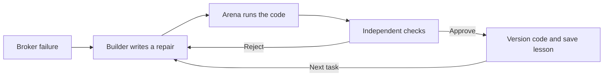

# TradeOnce

**Autonomous code repair for trading agents, verified against the broker's records.**

A trading agent asks to buy one share. The broker buys it, but its reply gets lost.
The agent retries and buys another. TradeOnce repairs the execution code,
checks the result independently, and saves what worked for the next failure.

Built for **The System That Gets Better** at the AIE Code Summit Hackathon.

## Real coding demo: one timeout, two orders, one lesson

The demo follows five steps:

1. **The mistake:** wanted 1 share; the broker bought 2.
2. **The repair:** Gemini 4 Argon writes a real Python change.
3. **The check:** the broker's records confirm the right amount was bought, even when replies fail.
4. **The lesson:** only approved Builder guidance and lessons enter MongoDB memory.
5. **The next problem:** start with the original broken code and reuse the saved guidance on a related failure.

### Try the recorded run

Requires Python 3.12 or 3.13 and [uv](https://docs.astral.sh/uv/).
No API keys or database connection are needed for replay.

```bash
uv sync --locked --extra presentation
uv run --extra presentation python -m builder.terminal_view --replay demo/recorded/argon-coding.json
```

The interactive terminal folds completed steps into short summaries. Open any
heading to inspect the outcome. Replay is clearly labeled as a recorded live run.

### Start a fresh run

Configure `GEMINI_API_KEY` and `MONGODB_URI` in your private `.env` using
[the setup guide](docs/development.md#setup), then run:

```bash
direnv exec . uv run --extra presentation python -m builder.terminal_view
```

Fresh code execution requires macOS and `sandbox-exec`. This coding demo uses
our simulated broker; it places no real broker orders.

## Harness² refinement and persistent memory

Two things improve: the **Executor**, which places trades, and the **Builder's
instructions and lessons**, which guide its next repair. Google Research
Harness² refines the Builder guidance; Gemini produces the code changes.



The fixed auditor and private evaluation own the approval decision. The Builder
receives public failures and execution traces, while held-out cases stay private.
Rejected candidates retain the approved code and memory.

[Framework integration and API examples](docs/development.md#harness²-refinement-and-persistent-memory)
cover the refinement callbacks, memory contract and extension points.

## Engineering behind the demo

| Mechanism | What it establishes |
| --- | --- |
| Real code execution | Candidates are generated Python patches, run against an Alpaca-shaped broker simulator. |
| Independent verification | A deterministic auditor reads the broker ledger; the Builder's own success claim cannot approve a repair. |
| Regression and held-out evaluation | Fixes must preserve earlier behavior and handle cases outside the Builder's visible inputs. |
| Execution isolation | Generated code runs with restricted filesystem and network access, without model keys, database credentials or hidden fixtures. |
| Versioned, verified memory | Git identifies each candidate; MongoDB ties approved lessons to their code and verification proof. Revision checks reject stale memory writes. |
| Inspectable evidence | Typed results, actual diffs, broker positions and run events support replay and review. |

## What we measured

The [recorded coding run](demo/recorded/argon-coding.json) repaired two related failures:

| Task | Code proposals | Measured time |
| --- | --- | --- |
| Broker accepted the order, then its reply timed out | 3 | 147 seconds |
| Related broker error, starting again from broken code with the approved lesson | 1 | 36 seconds |

The tasks differ; this is observed transfer in one run, not a guaranteed speedup.

We also connected the repaired Executor to the unmodified **ai-hedge-fund**
agent. Across six matched scenarios on **Alpaca paper**, the original Executor
produced **3 duplicate orders**; the Gemini-written version produced **none**
and completed all six scenarios safely by our checks.

This comparison uses fake money, real broker API calls, injected faults and
cached stand-in analyst signals. See the [recorded paper-broker results](agent_bridge/reports/side_by_side.json)
and [Executor provenance](demo/promoted/argon-v2/PROVENANCE.md).

## Current scope

The autonomous coding path is `builder.demo`, also used by the interactive
terminal. The separate shared round loop still defaults to hand-written
candidates. The saved Gemini Executor handles the demonstrated timeout and
error-reply repairs; partial fills remain a known gap.

The [demo evidence guide](docs/demo-evidence.md) connects the underlying broker
behavior to external reports and distinguishes verified runs from proposed scenes.

## Built during the hackathon

We built the Arena and fault injection, Executor repair workflow, independent
auditor, Harness² adapter, MongoDB memory integration, model clients,
external-agent adapter and terminal presentation.

We build on [Google Research Harness²](https://github.com/google-research/harness2)
(Apache-2.0), Gemini, MongoDB and
[ai-hedge-fund](https://github.com/virattt/ai-hedge-fund) (MIT). The external
agent's pipeline remains its authors' work and is used unmodified.

## Developer documentation

- [Development guide](docs/development.md): setup, storage and provider clients, framework APIs, recording and validation.
- [Architecture and integration contracts](AGENTS.md): module responsibilities and teammate extension points.
- [Submission draft](SUBMISSION.md): project description and one-minute video placeholder.
